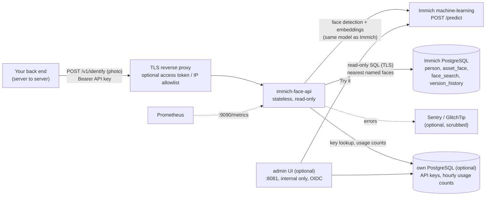

# immich-face-api

[](https://github.com/alee-ibrahim/immich-face-api/actions/workflows/ci.yml)
[](LICENSE)
[](#compatibility-and-the-version-pin)

**"Who is in this photo?"** A small, read-only HTTP API that sits next to an [Immich](https://immich.app) server. Send it
a photo; it finds the faces and returns, for each one, the **named Immich person** it most likely shows (or `null`).

- [Why](#why) · [How it works](#how-it-works) · [Quick start](#quick-start-docker-compose) · [Configuration](#configuration)
- [Admin UI](#admin-ui-optional) · [API](#api) · [Client examples](#client-examples) · [Matching](#the-matching-algorithm) · [Security](#security-model)
- [Privacy](#privacy-and-biometric-data) · [Compatibility](#compatibility-and-the-version-pin) · [Upgrading](#upgrading-immich)
- [Troubleshooting](#troubleshooting) · [FAQ](#faq) · [Limitations](#limitations) · [Development](#development)

## Why

Immich is great at finding and grouping faces in a photo library, and curators can name the people. But that knowledge
stays inside Immich. Websites, newsrooms, archives or DAM systems often hold **other** copies of photos (an event
gallery, a press archive) and want to tag the people in them **without** uploading everything into Immich or running a
second face-recognition system.

immich-face-api reuses what Immich already has:

- **the same face model** (Immich's machine-learning server, same model and detection threshold), so its embeddings are
  directly comparable with Immich's;
- **the names curators gave** in Immich, read-only, from one library owner;

and turns them into one API call that returns **suggestions** for a human to confirm. It does not change Immich, never
stores an image or embedding, and reads only four tables of Immich's database.

## How it works



For each request:

1. **Validate in memory:** API key, rate limit, body size (default 15 MB), magic bytes (JPEG, PNG, WebP, HEIC/HEIF;
   camera JPEGs with an embedded preview, "MPO", count as JPEG), header-only open with that one decoder, pixel limit
   (default 50 MP) **before** decoding.
2. **Normalise:** apply EXIF orientation, create a **new** RGB image without any metadata (EXIF, GPS, XMP, ICC dropped), sent to ML losslessly as PNG,
   longest edge 1440 px (Immich's preview size; Immich detects faces on its preview, so this keeps embeddings comparable).
3. **Detect + embed:** `POST /predict` to Immich's ML server with exactly the request Immich makes:
   `{"facial-recognition": {"detection": {"modelName": M, "options": {"minScore": S}}, "recognition": {"modelName": M}}}`.
4. **Search:** for each face, the k nearest faces (exact cosine distance) among faces of persons that belong to **one
   Immich user** (the library owner), have a **non-empty name** and are **not hidden**, on assets that are not deleted,
   trashed or in the locked folder.
5. **Decide:** "nearest face wins" (see [Matching](#the-matching-algorithm)) and answer. Nothing is kept.

## Quick start (docker compose)

Next to an Immich installed with its official `docker-compose.yml` (containers `immich_machine_learning` and
`immich_postgres` on the network `immich_default`):

```bash
git clone https://github.com/alee-ibrahim/immich-face-api && cd immich-face-api/examples/compose

# 1. read-only database role (once), then give it a password interactively
docker exec -i immich_postgres psql -U postgres -d immich < ../readonly-role.sql
docker exec -it immich_postgres psql -U postgres -d immich      # then:  \password immich_face_api
"${EDITOR:-vi}" db_password.txt && chmod 600 db_password.txt   # the same password (not on the command line)

# 2. settings: owner id (Immich -> Administration -> Users -> user; the id is in the URL), model, version
cp .env.example .env && "${EDITOR:-vi}" .env

# 3. an API key for your client, and its hash for the service
docker run --rm --entrypoint python ghcr.io/alee-ibrahim/immich-face-api:main -m immich_face_api.keys new > client.key
HASH=$(docker run --rm -i --entrypoint python ghcr.io/alee-ibrahim/immich-face-api:main -m immich_face_api.keys hash < client.key)
printf '{"my-client": "%s"}\n' "$HASH" > api-keys.json

# 4. run and check
docker compose up -d
curl -s localhost:8080/readyz              # {"status":"ready"}
../clients/identify.sh client.key some-photo.jpg   # with FACE_API_URL=http://localhost:8080
```

Kubernetes: plain manifests in [`examples/kubernetes/`](examples/kubernetes) (Deployment with a hardened pod, Service,
NetworkPolicy, Secret example). Keep it behind your ingress with only `/v1/identify`, `/v1/people` and `/healthz` routed.

## Configuration

Every setting is an environment variable. `*_FILE` variants read the value from a file (mounted secrets) and win
over the plain variable.

| Variable | Default | Description |
| --- | --- | --- |
| `FACE_API_ML_URL` | **required** | Immich machine-learning server, e.g. `http://immich-machine-learning:3003` |
| `FACE_API_FACE_MODEL` | `buffalo_l` | must equal Immich's *Facial Recognition → model* |
| `FACE_API_MIN_SCORE` | `0.7` | must equal Immich's *minimum detection score* |
| `FACE_API_MAX_DISTANCE` | `0.5` | match limit (cosine distance); Immich's *maximum recognition distance*. Lower = fewer, safer suggestions |
| `FACE_API_MAX_EDGE` | `1440` | longest edge sent to ML; Immich's preview size |
| `FACE_API_DB_HOST` | `localhost` | Immich PostgreSQL host |
| `FACE_API_DB_PORT` | `5432` | |
| `FACE_API_DB_NAME` | `immich` | |
| `FACE_API_DB_USER` | `immich_face_api` | the read-only role |
| `FACE_API_DB_PASSWORD` / `_FILE` | | |
| `FACE_API_DB_SSLMODE` | `verify-full` | `disable`, `require`, `verify-ca`, `verify-full` |
| `FACE_API_DB_SSLROOTCERT` | | CA certificate file for `verify-*` |
| `FACE_API_DB_POOL_SIZE` | `4` | connections per replica |
| `FACE_API_OWNER_ID` | | Immich user id (uuid) whose named people count. Preferred: no access to the `user` table needed |
| `FACE_API_OWNER_EMAIL` | | alternative to `OWNER_ID`; needs `SELECT (id, email) ON "user"` |
| `FACE_API_EXPECTED_IMMICH_VERSION` | `3.4.1` | the version pin, see [Compatibility](#compatibility-and-the-version-pin) |
| `FACE_API_API_KEYS` / `_FILE` | **required** | JSON `{"client-name": "<sha256 hex of its key>"}`. Plain keys are refused |
| `FACE_API_RATE_LIMIT_PER_MINUTE` | `30` | per client and replica (token bucket) |
| `FACE_API_RATE_LIMIT_BURST` | `10` | |
| `FACE_API_MAX_CONCURRENT_ML` | `2` | images in the ML server at once, per replica |
| `FACE_API_ML_QUEUE_TIMEOUT` | `20` | seconds to wait for a slot, then `503 busy` |
| `FACE_API_ML_TIMEOUT` | `60` | seconds per ML request |
| `FACE_API_MAX_UPLOAD_BYTES` | `15728640` | 15 MiB |
| `FACE_API_MAX_PIXELS` | `50000000` | checked before decoding |
| `FACE_API_KNN` | `20` | neighbours per face |
| `FACE_API_MAX_CANDIDATES` | `5` | cap for `?candidates=` |
| `FACE_API_AMBIGUITY_MARGIN` | `0.03` | runner-up this close → `ambiguous: true` |
| `FACE_API_ENABLE_PEOPLE` | `true` | `GET /v1/people` |
| `FACE_API_ENABLE_OPENAPI` | `true` | `GET /openapi.json` (keep it internal) |
| `FACE_API_TEST_MODE` | `false` | allows `include_unnamed=1`. **Never in production** |
| `FACE_API_METRICS_PORT` | `9090` | Prometheus `/metrics` on its own port; `0` = off |
| `FACE_API_READINESS_INTERVAL` | `60` | seconds between readiness checks |
| `FACE_API_SENTRY_DSN` / `_FILE` | | Sentry or GlitchTip DSN; events are scrubbed (see [Security](#security-model)) |
| `FACE_API_ENVIRONMENT` | `production` | Sentry environment |

API port **8080**. Image `ghcr.io/alee-ibrahim/immich-face-api` (Alpine, uid 65532, read-only root filesystem works,
nothing written to disk; amd64 and arm64 for releases).

### API keys

One key per client. Only its **SHA-256** is configured; keys are compared in constant time. A key is a long random
string, so a plain hash is enough.

```bash
docker run --rm --entrypoint python ghcr.io/alee-ibrahim/immich-face-api:main -m immich_face_api.keys new > website.key
docker run --rm -i --entrypoint python ghcr.io/alee-ibrahim/immich-face-api:main -m immich_face_api.keys hash < website.key
```

Give `website.key` to the client over a secure channel; put `{"website": "<hash>"}` into `FACE_API_API_KEYS`.
Rotate: add `"website-2027": "<new hash>"`, switch the client, remove the old entry. Client names appear in logs and
metrics, never the key.

### Database role

[`examples/readonly-role.sql`](examples/readonly-role.sql): `SELECT` on `person`, `asset_face`, `face_search`,
`version_history` only, read-only transactions, a TLS-only `pg_hba` line. The service also sets
`default_transaction_read_only` and a 15 s statement timeout on every connection.

## Admin UI (optional)

A small web UI for the people who run the service: **usage analytics** and **API keys per app**. It is a separate
process from the same image (`python -m immich_face_api admin`, port **8081**). Keep it on an internal network and
never route it publicly; the API port (8080) never serves it. Its paths (`/`, `/login`, `/auth/callback`, `/logout`,
`/usage`, `/keys`, `/try`, `/docs`, `/static`) do not overlap the API's (`/v1/*`, `/healthz`, `/openapi.json`), so one
internal hostname can serve both: route `/v1/` and `/healthz` to the API, everything else to the admin.

| Page | What |
| --- | --- |
| Dashboard | identify requests, faces detected, match rate, unknown rate, latency p50/p95, errors and refusals for 24 h / 7 d / 30 d / 90 d; charts per hour or day; per-app table |
| Usage | the same for one app, with a table view |
| Apps & keys | create a key for an app (owner, label, rate limit per minute, expiry); the key is **shown once**; revoke; last used; an audit list of who created or revoked what. Keys from `FACE_API_API_KEYS` are listed read-only |
| Try it | upload a photo, see the boxes and names drawn over it (same pipeline as `/v1/identify`); nothing is stored or counted |
| Docs | quick start, authentication, endpoints with examples (curl, PHP/Laravel, Python, Node; language tabs and copy buttons), limits, errors, best practices; an API reference rendered from the bundled OpenAPI document and a download of `openapi.json`. The base URL shown is `FACE_API_DOCS_BASE_URL` (default: the request's own host) |

**Keys made in the UI** look like `ifa_<8 hex>_<43 random characters>`. The prefix is stored in clear (to tell keys
apart and to find them), the whole key only as SHA-256; it is compared in constant time. A key can carry its own rate
limit and an expiry; revoking takes effect within `FACE_API_KEY_CACHE_SECONDS` (30 s). Keys from the environment keep
working unchanged, so existing clients need no change; to move one into the UI, create a key for it there, switch the
client, then remove it from `FACE_API_API_KEYS`.

**Store.** Keys and analytics need the service's **own** small PostgreSQL (`FACE_API_STORE_URL`), never Immich's
database: Immich stays read-only. Tables are created on start (`immich_face_api/migrations/`). Analytics are hourly
**aggregates only** (counts per app and endpoint, and a latency histogram): no images, embeddings, names, IP addresses
or keys; kept `FACE_API_USAGE_RETENTION_DAYS` (400). The API pods write their counts every 30 s.

**Sign-in.** Any OpenID Connect provider (`FACE_API_OIDC_ISSUER`, or `FACE_API_OIDC_TENANT_ID` for Microsoft Entra,
plus client id and secret; redirect URI `<FACE_API_PUBLIC_URL>/auth/callback`). Who may sign in: by default whoever the
provider lets through (for example an Entra app with *Assignment required*); to require a claim, set
`FACE_API_OIDC_ADMIN_CLAIM` (e.g. `roles` or `groups`) and `FACE_API_OIDC_ADMIN_VALUES` (comma-separated). Without
OIDC, a bootstrap admin token (`FACE_API_ADMIN_TOKEN`) signs in, for local use. Sessions are signed cookies (8 h,
`SameSite=Lax`, `Secure`), every form carries a CSRF token, and a strict Content-Security-Policy allows no inline script
or style.

| Variable | Default | Description |
| --- | --- | --- |
| `FACE_API_STORE_URL` / `_FILE` | | the store, e.g. `postgresql://face_api@store-host:5432/face_api?sslmode=verify-full&sslrootcert=/ca.crt`. Enables UI-made keys and analytics in the API too |
| `FACE_API_STORE_PASSWORD` / `_FILE` | | store password (kept out of the URL) |
| `FACE_API_STORE_POOL_SIZE` | `4` | |
| `FACE_API_USAGE_RETENTION_DAYS` | `400` | hourly aggregates older than this are deleted |
| `FACE_API_KEY_CACHE_SECONDS` | `30` | how long a key lookup is cached (a revoke takes effect within this) |
| `FACE_API_ADMIN_PORT` | `8081` | admin UI port |
| `FACE_API_PUBLIC_URL` | | the admin UI's own URL, e.g. `https://faces-admin.example.org` (OIDC redirect) |
| `FACE_API_SESSION_SECRET` / `_FILE` | | at least 32 random characters; required with OIDC |
| `FACE_API_SESSION_HTTPS_ONLY` | `true` | `Secure` cookie; `false` only for local plain HTTP |
| `FACE_API_OIDC_ISSUER` | | issuer URL (discovery at `/.well-known/openid-configuration`) |
| `FACE_API_OIDC_TENANT_ID` | | Microsoft Entra shortcut for the issuer |
| `FACE_API_OIDC_CLIENT_ID` / `_FILE`, `FACE_API_OIDC_CLIENT_SECRET` / `_FILE` | | |
| `FACE_API_OIDC_SCOPES` | `openid email profile` | |
| `FACE_API_OIDC_ADMIN_CLAIM`, `FACE_API_OIDC_ADMIN_VALUES` | | optional claim filter (see above) |
| `FACE_API_ADMIN_TOKEN` / `_FILE` | | bootstrap sign-in when OIDC is not configured |
| `FACE_API_DOCS_BASE_URL` | request host | the API base URL shown in the admin docs (e.g. the public API host) |

With a store configured, `FACE_API_API_KEYS` becomes optional.

## API

OpenAPI 3.1: [`immich_face_api/openapi.json`](immich_face_api/openapi.json), also served at `GET /openapi.json`.
All `/v1` endpoints need the API key: `Authorization: Bearer <api key>` or `X-API-Key: <api key>`. Responses are JSON with `Cache-Control: no-store`.
There is **no CORS**: call it from your server, never from a browser.

### `POST /v1/identify`

Body: `multipart/form-data` with the file in field **`image`**, or the raw image bytes.

| Query | Default | |
| --- | --- | --- |
| `candidates` | `0` | also return up to N ranked candidates per face |
| `include_unnamed` | off | test mode only: also match unnamed clusters (name `null`), to check matching on a library where few people are named |

```bash
curl -sS "https://faces.example.org/v1/identify?candidates=3" -H "Authorization: Bearer $KEY" -F image=@event.jpg
```

```json
{
  "faces": [
    {
      "box": {"x": 0.412, "y": 0.18, "w": 0.061, "h": 0.103},
      "detection_score": 0.83,
      "person_id": "6f1c1f0e-8d0a-4c55-9d43-4f0b1d1f2a10",
      "name": "Jane Example",
      "confidence": 0.71,
      "distance": 0.29,
      "ambiguous": false,
      "candidates": [
        {"person_id": "6f1c1f0e-8d0a-4c55-9d43-4f0b1d1f2a10", "name": "Jane Example", "confidence": 0.71, "distance": 0.29, "votes": 7},
        {"person_id": "0b7e3b7c-1a52-4d0e-9a9e-2f7c9a1d5e33", "name": "John Example", "confidence": 0.53, "distance": 0.47, "votes": 1}
      ]
    },
    {
      "box": {"x": 0.702, "y": 0.22, "w": 0.055, "h": 0.094},
      "detection_score": 0.79,
      "person_id": null, "name": null, "confidence": null, "distance": null, "ambiguous": false,
      "candidates": []
    }
  ],
  "image": {"w": 6000, "h": 4000},
  "model": "buffalo_l",
  "max_distance": 0.5,
  "immich_version": "3.4.1"
}
```

| Field | Meaning |
| --- | --- |
| `box` | fractions (0–1) of the **upright** image (after EXIF rotation); `x`,`y` = top-left. Pixels = fraction × `image.w` / `image.h`. Faces are sorted left to right |
| `detection_score` | face detector confidence (≥ `minScore`) |
| `person_id` | Immich person group id; stable across renames and Immich's people sharing. Store it with confirmed tags |
| `name` | as typed in Immich; `null` = no named person close enough |
| `distance` | cosine distance to that person's nearest face (0 = same face; matches only up to `max_distance`) |
| `confidence` | 1 − distance: a hint for a human, **not** a probability |
| `ambiguous` | the runner-up is within `FACE_API_AMBIGUITY_MARGIN`: show the candidates, pre-select nothing |
| `candidates[].votes` | how many of the k nearest faces belong to that person |

### `GET /v1/people`

Named, not hidden people of the owner, with their number of faces (for a "pick someone else" list):

```json
{"people": [{"person_id": "6f1c1f0e-8d0a-4c55-9d43-4f0b1d1f2a10", "name": "Jane Example", "face_count": 42}], "count": 1}
```

### Health

- `GET /healthz` → `{"status":"ok"}` while the process runs (liveness).
- `GET /readyz` → `200` only when the Immich version and table shapes match the pin, the role can read its tables, the
  owner exists and the ML server answers; re-checked every `FACE_API_READINESS_INTERVAL` s. The reason is logged
  (`"readiness changed"`), not returned. While not ready, `/v1/*` answers `503`.

### Errors

`{"error": {"code": "...", "message": "..."}}`:

| Status | `code` | When | Client action |
| --- | --- | --- | --- |
| 400 | `bad_request`, `invalid_image` | missing `image` field, bad query, undecodable file | fix the request; don't retry |
| 401 | `unauthorized` | missing or wrong key | check the key |
| 404 | `not_found` | disabled endpoint | — |
| 413 | `too_large`, `invalid_image` | over the size or pixel limit | send a web-size copy (3000 px is plenty) |
| 415 | `invalid_image` | not JPEG/PNG/WebP/HEIC | convert first |
| 429 | `rate_limited` | over the client's rate | wait `Retry-After` |
| 502 | `upstream` | ML server or database failed | retry later |
| 503 | `not_ready`, `busy` | version/schema mismatch, dependency down, or the ML queue is full | wait `Retry-After` |

## Client examples

Complete files in [`examples/clients/`](examples/clients): [Python](examples/clients/identify.py),
[PHP / Laravel](examples/clients/FaceApiClient.php), [Node](examples/clients/identify.mjs), [curl](examples/clients/identify.sh).
All read the key from a file or secret store, never from the command line, and retry on 429/502/503.

Python:

```python
import httpx

with open("photo.jpg", "rb") as fh:
    r = httpx.post(
        f"{URL}/v1/identify",
        params={"candidates": 3},
        files={"image": fh},
        headers={"Authorization": f"Bearer {KEY}"},
        timeout=120,
    )
r.raise_for_status()
for face in r.json()["faces"]:
    print(face["box"], face["name"] or "unknown")
```

PHP / Laravel:

```php
$faces = Http::withToken(config('services.face_api.key'))->timeout(120)
    ->attach('image', $jpegBytes, 'photo.jpg')
    ->post(config('services.face_api.url').'/v1/identify?candidates=3')
    ->throw()->json('faces');
```

Node:

```js
const form = new FormData();
form.append("image", new Blob([await readFile("photo.jpg")]), "photo.jpg");
const res = await fetch(`${url}/v1/identify?candidates=3`, { method: "POST", headers: { Authorization: `Bearer ${key}` }, body: form });
const { faces } = await res.json();
```

**Suggested integration pattern:** call it from a background job when a photo is added; store the result as *pending
suggestions* (box, person id, name, distance, ambiguous); show staff the boxes with "Jane Example? ✓ ✗"; store only
**confirmed** tags in your own database (with the `person_id`); refresh display names from `GET /v1/people`; never
publish unconfirmed suggestions.

## The matching algorithm

For each detected face:

1. Take the **k = 20** nearest faces (exact cosine distance) among the owner's **named, visible** faces.
2. Drop neighbours farther than **`max_distance`** (0.5).
3. Group by person. A person's score is their **best (smallest) distance**; ties go to the person with more neighbours.
4. The best person is the match; the following ones are the candidates. If the runner-up is within
   `ambiguity_margin` (0.03), `ambiguous` is `true`.

**Why "nearest face wins" and not a vote?** Immich itself assigns a new face to the person of its nearest matching face,
so the API agrees with what curators see in Immich. A majority vote over the k neighbours favours people with many
photos (someone who appears in thousands of photos fills the k slots even when another person is closer) and misses
people who were named only recently, with a handful of faces. The `votes` count is still returned as extra evidence.

**Why exact search?** Immich's `face_index` (VectorChord `vchordrq`) is an approximate index that is searched before the
"named, this owner" filter is applied; for such a selective filter it can return too few rows or none. The named faces
are a small part of a library, so an exact scan is fast (about 20 ms per 1,000 named faces per detected face on a small
server) and always correct.

**Thresholds.** `distance` is the same measure Immich uses for clustering. 0.5 matches Immich's default; a lower value
(0.4–0.45) gives fewer but safer suggestions, which is usually right when a wrong public name is worse than none.

## Security model

| Layer | What it does |
| --- | --- |
| Transport | plain HTTP on 8080; put a TLS reverse proxy in front. The API key is the authentication and is enough on its own; for internet exposure add a body-size cap, a timeout and a per-IP rate limit at the proxy. An IP allowlist or an access-service token at the proxy is optional extra hardening |
| Authentication | per-client API key; only SHA-256 hashes are configured; constant-time compare over all keys. Checked **first**: before the request body is read or decoded and before any ML or database call, so an unauthenticated request costs one hash |
| Authorization | a client can identify and list named people; nothing else exists |
| Abuse | token bucket per client, bounded ML concurrency with queue timeout, 15 MB / 50 MP limits, no OpenAPI UI, metrics on another port |
| Input | magic bytes, one decoder per format, pixel limit before decoding, first frame only, metadata never passed on |
| Data | images and embeddings stay in memory for the request only; read-only DB role on four tables; every transaction read-only; no Immich API key, no access to Immich's files |
| Browser | no CORS headers ever: browsers cannot read responses cross-origin |
| Logs | one JSON line per request: client name, status, duration, number of faces and matches, request id, `CF-Connecting-IP` if present. Never image data, embeddings, names or keys |
| Error reports | optional Sentry/GlitchTip: `send_default_pii` off, no local variables, no request body/headers/cookies/query/user/server name; tokens, e-mails, vectors and long key-like strings redacted in messages, breadcrumbs, tags and extra |
| Container | Alpine, non-root uid 65532, read-only root filesystem, no capabilities needed; CI fails on Critical CVEs; releases signed with Cosign and shipped with an SBOM |

Report vulnerabilities privately: [SECURITY.md](SECURITY.md).

## Privacy and biometric data

Face embeddings are **biometric data**, and naming people in Immich builds a face register. Running this service means
processing biometric data of everyone in the photos you send. **Whether that is lawful, and under which conditions
(consent, legitimate interest, the public role of the people concerned, a data protection impact assessment,
retention, informing people), is the deployer's responsibility.** This project gives no legal advice.

What the design does to help:

- It stores **no images and no embeddings** of uploads; it has no database of its own.
- It only returns names a curator chose to type into Immich, for one owner's library; unnamed and hidden people are
  never returned (except in test mode, and then without a name).
- It is built for **suggestions that a human confirms**, not for automatic identification; do not build a public
  "find this face" search on top of it.

## Compatibility and the version pin

| immich-face-api | Immich | Model tested |
| --- | --- | --- |
| 0.1.x | **3.4.1** | `buffalo_l` (CPU, ONNX) |

The service reads Immich's **internal** tables, which can change in any Immich release. It therefore pins one Immich
version (`FACE_API_EXPECTED_IMMICH_VERSION`, compared with Immich's `version_history` table) and checks every column it
reads and its type. On any difference it reports **not ready** and refuses requests with `503`, instead of returning
wrong answers. Policy:

- A release of this project states the Immich version(s) it was tested with (table above, CHANGELOG).
- Changing `FACE_API_EXPECTED_IMMICH_VERSION` to an untested version is possible, at your own risk; the column check
  still protects against the obvious breakages.
- The face model and `minScore` are not readable from Immich's database when Immich is configured by a config file, so
  they are configuration here: keep them equal to Immich's settings.

## Upgrading Immich

1. Before upgrading Immich, check this project's releases for one that supports the new version.
2. If there is none yet, test on a copy: restore Immich's database to a test instance of the new version, run this
   service against it with `FACE_API_EXPECTED_IMMICH_VERSION=<new>`, and check `/readyz` and the `readiness changed` log.
3. Compare Immich's ML request (`server/src/repositories/machine-learning.repository.ts`, `detectFaces`) and the face
   filters (`asset_face.deletedAt`, `isVisible`, `assetDeletedAt`, `assetVisibility`, `person.isHidden`).
4. Upgrade Immich and this service together; if the role's grants were lost (a table was recreated), run
   `examples/readonly-role.sql` again.

## Troubleshooting

| Symptom | Cause / fix |
| --- | --- |
| `/readyz` 503, log `Immich version X != pinned Y` | Immich was upgraded: see [Upgrading Immich](#upgrading-immich) |
| log `Immich schema differs: …` | a column changed or disappeared: this version does not support your Immich |
| log `no SELECT privilege on …` | grants missing or lost after a migration: run `examples/readonly-role.sql` |
| log `owner account not found` | `FACE_API_OWNER_EMAIL` does not match an Immich user; use `FACE_API_OWNER_ID` |
| log `dependency check failed: … machine-learning server not reachable` | wrong `FACE_API_ML_URL` or a network policy |
| `dependency check failed: OperationalError` | DB host, password, `pg_hba` or TLS (`verify-full` needs `FACE_API_DB_SSLROOTCERT` and a matching host name) |
| Everyone is `null` | nobody is named yet, the people belong to another user than `OWNER_ID`, the names were given only in a curator's own library, or `MAX_DISTANCE` is too strict |
| Wrong names | a cluster was merged or named wrongly in Immich (fix it there; the next call uses it), or `MAX_DISTANCE` is too loose |
| Fewer faces than Immich finds | `MIN_SCORE` or model differ from Immich's settings, or the photo is much smaller than Immich's preview |
| `413` | send a smaller copy; faces are detected on a 1440 px version anyway |
| `503 busy` / slow | the ML server is busy (e.g. Immich's initial indexing); raise `MAX_CONCURRENT_ML` or ML capacity later |

## FAQ

**Does it need an Immich API key?** No. It never talks to the Immich server, only to the ML server and the database.

**Can it use the people of all users?** One owner per instance, by design: names are curated in one library. Run a
second instance for a second owner.

**Does it add the photo to Immich, or learn from it?** No. Nothing is written anywhere. Improve recognition by naming
and merging people in Immich.

**GPU?** It uses whatever Immich's ML server uses. The service itself is light (decoding and a SQL query).

**Can I call it from JavaScript in the browser?** No: the key would leak, and there is no CORS on purpose. Call it from
your server.

**Is `confidence` a probability?** No, it is `1 − distance`, a similarity score to help a human decide.

**Why MIT and not AGPL like Immich?** It contains no Immich code; it only speaks to Immich over HTTP and SQL.

## Limitations

- Pinned to specific Immich versions (see above); internal schema changes need a new release.
- One library owner per instance.
- Exact search scales to some tens of thousands of named faces; beyond that an index with pre-filtering or an in-memory
  cache would be needed.
- Rate limits are per replica (in memory), not global.
- Face recognition is not perfect: twins, children growing up, masks, profile views and tiny or blurred faces cause
  misses and wrong suggestions. Always keep a human in the loop.
- Animated images: only the first frame is analysed. Videos are not supported.

## Development

```bash
python -m venv .venv && . .venv/bin/activate        # Python 3.13
pip install -r requirements-dev.txt
ruff check . && ruff format --check . && pytest
```

Tests use synthetic images (gradients, solid colours) and a mocked ML server and database: there are no photos of
real people and no embeddings in this repository; please keep it that way. See [CONTRIBUTING.md](CONTRIBUTING.md) and
[CHANGELOG.md](CHANGELOG.md).

## Licence

MIT, see [LICENSE](LICENSE). Immich is a trademark of its owners; this project is not affiliated with or endorsed by
the Immich project.
