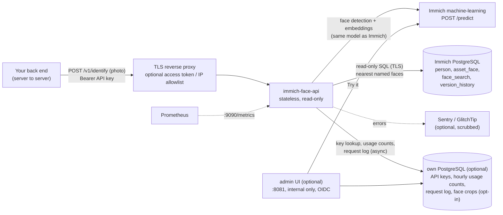

# immich-face-api

[](https://github.com/alee-ibrahim/immich-face-api/actions/workflows/ci.yml)
[](LICENSE)
[](#compatibility-and-the-version-pin)

**"Who is in this photo?"** A small, read-only HTTP API that sits next to an [Immich](https://immich.app) server. Send it
a photo; it finds the faces and returns, for each one, the **named Immich person** it most likely shows (or `null`).

- [Why](#why) · [How it works](#how-it-works) · [Quick start](#quick-start-docker-compose) · [Configuration](#configuration)
- [Admin UI](#admin-ui-optional) · [Request log and face crops](#request-log-and-face-crops) · [API](#api) · [Client examples](#client-examples) · [Matching](#the-matching-algorithm) · [People changes](#people-changes) · [Security](#security-model)
- [Privacy](#privacy-and-biometric-data) · [Compatibility](#compatibility-and-the-version-pin) · [Upgrading](#upgrading-immich)
- [Troubleshooting](#troubleshooting) · [FAQ](#faq) · [Limitations](#limitations) · [People labeler](#people-labeler) · [Development](#development)

## Why

Immich is great at finding and grouping faces in a photo library, and curators can name the people. But that knowledge
stays inside Immich. Websites, newsrooms, archives or DAM systems often hold **other** copies of photos (an event
gallery, a press archive) and want to tag the people in them **without** uploading everything into Immich or running a
second face-recognition system.

immich-face-api reuses what Immich already has:

- **the same face model** (Immich's machine-learning server, same model and detection threshold), so its embeddings are
  directly comparable with Immich's;
- **the names curators gave** in Immich, read-only, from one library owner;

and turns them into one API call that returns **suggestions** for a human to confirm. It does not change Immich, never
stores an uploaded photo, and reads only four tables of Immich's database. (With the optional admin store it can keep a
[request log and face crops](#request-log-and-face-crops) for curators; crops are off by default.)

## How it works



For each request:

1. **Validate in memory:** API key, rate limit, body size (default 15 MB), magic bytes (JPEG, PNG, WebP, HEIC/HEIF;
   camera JPEGs with an embedded preview, "MPO", count as JPEG), header-only open with that one decoder, pixel limit
   (default 50 MP) **before** decoding.
2. **Normalise:** apply EXIF orientation, create a **new** RGB image without any metadata (EXIF, GPS, XMP, ICC dropped), sent to ML losslessly as PNG,
   longest edge 1440 px (Immich's preview size; Immich detects faces on its preview, so this keeps embeddings comparable).
3. **Detect + embed:** `POST /predict` to Immich's ML server with exactly the request Immich makes:
   `{"facial-recognition": {"detection": {"modelName": M, "options": {"minScore": S}}, "recognition": {"modelName": M}}}`.
4. **Search:** for each face, the k nearest faces (exact cosine distance) among faces of persons that belong to **one
   Immich user** (the library owner), have a **non-empty name** and are **not hidden**, on assets that are not deleted,
   trashed or in the locked folder.
5. **Decide:** "nearest face wins" (see [Matching](#the-matching-algorithm)) and answer. Nothing is kept.

## Quick start (docker compose)

Next to an Immich installed with its official `docker-compose.yml` (containers `immich_machine_learning` and
`immich_postgres` on the network `immich_default`):

```bash
git clone https://github.com/alee-ibrahim/immich-face-api && cd immich-face-api/examples/compose

# 1. read-only database role (once), then give it a password interactively
docker exec -i immich_postgres psql -U postgres -d immich < ../readonly-role.sql
docker exec -it immich_postgres psql -U postgres -d immich      # then:  \password immich_face_api
"${EDITOR:-vi}" db_password.txt && chmod 600 db_password.txt   # the same password (not on the command line)

# 2. settings: owner id (Immich -> Administration -> Users -> user; the id is in the URL), model, version
cp .env.example .env && "${EDITOR:-vi}" .env

# 3. an API key for your client, and its hash for the service
docker run --rm --entrypoint python ghcr.io/alee-ibrahim/immich-face-api:main -m immich_face_api.keys new > client.key
HASH=$(docker run --rm -i --entrypoint python ghcr.io/alee-ibrahim/immich-face-api:main -m immich_face_api.keys hash < client.key)
printf '{"my-client": "%s"}\n' "$HASH" > api-keys.json

# 4. run and check
docker compose up -d
curl -s localhost:8080/readyz              # {"status":"ready"}
../clients/identify.sh client.key some-photo.jpg   # with FACE_API_URL=http://localhost:8080
```

Kubernetes: plain manifests in [`examples/kubernetes/`](examples/kubernetes) (Deployment with a hardened pod, Service,
NetworkPolicy, Secret example). Keep it behind your ingress with only `/v1/*` and `/healthz` routed.

## Configuration

Every setting is an environment variable. `*_FILE` variants read the value from a file (mounted secrets) and win
over the plain variable.

| Variable | Default | Description |
| --- | --- | --- |
| `FACE_API_ML_URL` | **required** | Immich machine-learning server, e.g. `http://immich-machine-learning:3003` |
| `FACE_API_FACE_MODEL` | `buffalo_l` | must equal Immich's *Facial Recognition → model* |
| `FACE_API_MIN_SCORE` | `0.7` | must equal Immich's *minimum detection score* |
| `FACE_API_MAX_DISTANCE` | `0.5` | match limit (cosine distance); Immich's *maximum recognition distance*. Lower = fewer, safer suggestions |
| `FACE_API_MAX_EDGE` | `1440` | longest edge sent to ML; Immich's preview size |
| `FACE_API_DB_HOST` | `localhost` | Immich PostgreSQL host |
| `FACE_API_DB_PORT` | `5432` | |
| `FACE_API_DB_NAME` | `immich` | |
| `FACE_API_DB_USER` | `immich_face_api` | the read-only role |
| `FACE_API_DB_PASSWORD` / `_FILE` | | |
| `FACE_API_DB_SSLMODE` | `verify-full` | `disable`, `require`, `verify-ca`, `verify-full` |
| `FACE_API_DB_SSLROOTCERT` | | CA certificate file for `verify-*` |
| `FACE_API_DB_POOL_SIZE` | `4` | connections per replica |
| `FACE_API_OWNER_ID` | | Immich user id (uuid) whose named people count. Preferred: no access to the `user` table needed |
| `FACE_API_OWNER_EMAIL` | | alternative to `OWNER_ID`; needs `SELECT (id, email) ON "user"` |
| `FACE_API_EXPECTED_IMMICH_VERSION` | `3.4.1` | the version pin, see [Compatibility](#compatibility-and-the-version-pin) |
| `FACE_API_API_KEYS` / `_FILE` | **required** | JSON `{"client-name": "<sha256 hex of its key>"}`. Plain keys are refused |
| `FACE_API_RATE_LIMIT_PER_MINUTE` | `30` | per client and replica (token bucket) |
| `FACE_API_RATE_LIMIT_BURST` | `10` | |
| `FACE_API_MAX_CONCURRENT_ML` | `2` | images in the ML server at once, per replica |
| `FACE_API_ML_QUEUE_TIMEOUT` | `20` | seconds to wait for a slot, then `503 busy` |
| `FACE_API_ML_TIMEOUT` | `60` | seconds per ML request |
| `FACE_API_MAX_UPLOAD_BYTES` | `15728640` | 15 MiB |
| `FACE_API_MAX_PIXELS` | `50000000` | checked before decoding |
| `FACE_API_KNN` | `20` | neighbours per face |
| `FACE_API_FACE_CACHE` | `true` | search named faces in memory (see [Matching](#the-matching-algorithm)) |
| `FACE_API_FACE_CACHE_PER_PERSON` | `100` | faces cached per person |
| `FACE_API_FACE_CACHE_REFRESH_SECONDS` | `300` | how often to check named faces for changes |
| `FACE_API_MAX_CANDIDATES` | `5` | cap for `?candidates=` |
| `FACE_API_AMBIGUITY_MARGIN` | `0.03` | runner-up this close → `ambiguous: true` |
| `FACE_API_SAME_NAME_MAX_DISTANCE` | `0.6` | same-name people with centroids this close are one split person, not an ambiguity; `0` = off |
| `FACE_API_ENABLE_PEOPLE` | `true` | `GET /v1/people` |
| `FACE_API_ENABLE_OPENAPI` | `true` | `GET /openapi.json` (keep it internal) |
| `FACE_API_TEST_MODE` | `false` | allows `include_unnamed=1`. **Never in production** |
| `FACE_API_METRICS_PORT` | `9090` | Prometheus `/metrics` on its own port; `0` = off |
| `FACE_API_READINESS_INTERVAL` | `60` | seconds between readiness checks |
| `FACE_API_SENTRY_DSN` / `_FILE` | | Sentry or GlitchTip DSN; events are scrubbed (see [Security](#security-model)) |
| `FACE_API_ENVIRONMENT` | `production` | Sentry environment |

API port **8080**. Image `ghcr.io/alee-ibrahim/immich-face-api` (Alpine, uid 65532, read-only root filesystem works,
nothing written to disk; amd64 and arm64 for releases).

### API keys

One key per client. Only its **SHA-256** is configured; keys are compared in constant time. A key is a long random
string, so a plain hash is enough.

```bash
docker run --rm --entrypoint python ghcr.io/alee-ibrahim/immich-face-api:main -m immich_face_api.keys new > website.key
docker run --rm -i --entrypoint python ghcr.io/alee-ibrahim/immich-face-api:main -m immich_face_api.keys hash < website.key
```

Give `website.key` to the client over a secure channel; put `{"website": "<hash>"}` into `FACE_API_API_KEYS`.
Rotate: add `"website-2027": "<new hash>"`, switch the client, remove the old entry. Client names appear in logs and
metrics, never the key.

### Database role

[`examples/readonly-role.sql`](examples/readonly-role.sql): `SELECT` on `person`, `asset_face`, `face_search`,
`version_history` only, read-only transactions, a TLS-only `pg_hba` line. The service also sets
`default_transaction_read_only` and a 15 s statement timeout on every connection (the face cache and the people
change log raise it for their bulk reads, within a read-only transaction). The change log needs no other grant: it
reads `person` and `asset_face` (including `asset_face."updateId"`), not Immich's audit tables.

## Admin UI (optional)

A small web UI for the people who run the service: **usage analytics** and **API keys per app**. It is a separate
process from the same image (`python -m immich_face_api admin`, port **8081**). Keep it on an internal network and
never route it publicly; the API port (8080) never serves it. Its paths (`/`, `/login`, `/auth/callback`, `/logout`,
`/usage`, `/requests`, `/missed`, `/faces`, `/crops`, `/privacy`, `/keys`, `/try`, `/docs`, `/static`) do not overlap the API's (`/v1/*`, `/healthz`, `/openapi.json`), so one
internal hostname can serve both: route `/v1/` and `/healthz` to the API, everything else to the admin.

| Page | What |
| --- | --- |
| Dashboard | identify requests, faces detected, match rate, unknown rate, missed-face rate over time, top apps by unknown faces, latency p50/p95, errors and refusals for 24 h / 7 d / 30 d / 90 d; charts per hour or day; per-app table |
| Usage | the same for one app, with a table view |
| Requests | the request log: what each app asked and what was found, filterable; detail with face crops; *Stored data* with retention, sizes and **delete now**. See [Request log and face crops](#request-log-and-face-crops) |
| Missed faces | unknown, ambiguous and near-threshold faces with crops and their nearest named people; *find similar in Immich* |
| Apps & keys | create a key for an app (owner, label, rate limit per minute, expiry); the key is **shown once**; revoke; last used; an audit list of who created or revoked what. Keys from `FACE_API_API_KEYS` are listed read-only |
| Try it | upload a photo, see the boxes and names drawn over it (same pipeline as `/v1/identify`); nothing is stored or counted |
| Docs | quick start, authentication, endpoints with examples (curl, PHP/Laravel, Python, Node; language tabs and copy buttons), limits, errors, best practices; an API reference rendered from the bundled OpenAPI document and a download of `openapi.json`. The base URL shown is `FACE_API_DOCS_BASE_URL` (default: the request's own host) |

**Keys made in the UI** look like `ifa_<8 hex>_<43 random characters>`. The prefix is stored in clear (to tell keys
apart and to find them), the whole key only as SHA-256; it is compared in constant time. A key can carry its own rate
limit and an expiry; revoking takes effect within `FACE_API_KEY_CACHE_SECONDS` (30 s). Keys from the environment keep
working unchanged, so existing clients need no change; to move one into the UI, create a key for it there, switch the
client, then remove it from `FACE_API_API_KEYS`.

**Store.** Keys and analytics need the service's **own** small PostgreSQL (`FACE_API_STORE_URL`), never Immich's
database: Immich stays read-only. Tables are created on start (`immich_face_api/migrations/`, applied once each
under an advisory lock, so several pods can start at once). Analytics are hourly **aggregates** (counts per app and
endpoint, and a latency histogram): no images, embeddings, names, IP addresses or keys; kept
`FACE_API_USAGE_RETENTION_DAYS` (400). The API pods write their counts every 30 s. The store also holds the
[request log and face crops](#request-log-and-face-crops) if enabled.

**Sign-in.** Any OpenID Connect provider (`FACE_API_OIDC_ISSUER`, or `FACE_API_OIDC_TENANT_ID` for Microsoft Entra,
plus client id and secret; redirect URI `<FACE_API_PUBLIC_URL>/auth/callback`). Who may sign in: by default whoever the
provider lets through (for example an Entra app with *Assignment required*); to require a claim, set
`FACE_API_OIDC_ADMIN_CLAIM` (e.g. `roles` or `groups`) and `FACE_API_OIDC_ADMIN_VALUES` (comma-separated). Without
OIDC, a bootstrap admin token (`FACE_API_ADMIN_TOKEN`) signs in, for local use. Sessions are signed cookies (8 h,
`SameSite=Lax`, `Secure`), every form carries a CSRF token, and a strict Content-Security-Policy allows no inline script
or style.

| Variable | Default | Description |
| --- | --- | --- |
| `FACE_API_STORE_URL` / `_FILE` | | the store, e.g. `postgresql://face_api@store-host:5432/face_api?sslmode=verify-full&sslrootcert=/ca.crt`. Enables UI-made keys and analytics in the API too |
| `FACE_API_STORE_PASSWORD` / `_FILE` | | store password (kept out of the URL) |
| `FACE_API_STORE_POOL_SIZE` | `4` | |
| `FACE_API_USAGE_RETENTION_DAYS` | `400` | hourly aggregates older than this are deleted |
| `FACE_API_KEY_CACHE_SECONDS` | `30` | how long a key lookup is cached (a revoke takes effect within this) |
| `FACE_API_ADMIN_PORT` | `8081` | admin UI port |
| `FACE_API_PUBLIC_URL` | | the admin UI's own URL, e.g. `https://faces-admin.example.org` (OIDC redirect) |
| `FACE_API_SESSION_SECRET` / `_FILE` | | at least 32 random characters; required with OIDC |
| `FACE_API_SESSION_HTTPS_ONLY` | `true` | `Secure` cookie; `false` only for local plain HTTP |
| `FACE_API_OIDC_ISSUER` | | issuer URL (discovery at `/.well-known/openid-configuration`) |
| `FACE_API_OIDC_TENANT_ID` | | Microsoft Entra shortcut for the issuer |
| `FACE_API_OIDC_CLIENT_ID` / `_FILE`, `FACE_API_OIDC_CLIENT_SECRET` / `_FILE` | | |
| `FACE_API_OIDC_SCOPES` | `openid email profile` | |
| `FACE_API_OIDC_ADMIN_CLAIM`, `FACE_API_OIDC_ADMIN_VALUES` | | optional claim filter (see above) |
| `FACE_API_ADMIN_TOKEN` / `_FILE` | | bootstrap sign-in when OIDC is not configured |
| `FACE_API_DOCS_BASE_URL` | request host | the API base URL shown in the admin docs (e.g. the public API host) |

With a store configured, `FACE_API_API_KEYS` becomes optional.

## Request log and face crops

So that the people who run the service can see **what was asked** and **which faces were missed**, the API can keep a
request log and small face crops in the store. This is **off unless a store is configured**
(`FACE_API_STORE_URL`), and crops are **off by default**. It is the one place where this service keeps data about
faces, so read this section before switching crops on.

**Never stored:** the uploaded photo, IP addresses, API keys.

| What | When | Kept | Contents |
| --- | --- | --- | --- |
| Hourly counts | always with a store | `FACE_API_USAGE_RETENTION_DAYS` (400) | requests, faces, matched, ambiguous, errors, latency per app and hour. No names |
| Request log | `FACE_API_REQUEST_LOG=true` (default, with a store) | `FACE_API_REQUEST_LOG_RETENTION_DAYS` (90) | per `/v1/verify` call only the request line (time, app, status, latency, image size, counts); per `/v1/identify` call: time, app, status / error code, latency, request id, image bytes, width, height and format; counts of faces, matched, unknown, ambiguous and near-threshold faces; per face (at most `FACE_API_LOG_MAX_FACES`, 50): box, detection score, kind, the matched **person id, name and distance**, and the 3 nearest named people with distances **also beyond the threshold** (near-misses) |
| People change log | `FACE_API_CHANGES_INTERVAL` > 0 (default 300, with a store) | events `FACE_API_CHANGES_RETENTION_DAYS` (365); the snapshot is replaced at every check | ids and names of the owner's named people, which of them each face belongs to (ids only), and the change events (see [People changes](#people-changes)). No images, no embeddings |
| Face crops | `FACE_API_STORE_CROPS=unknown` or `all` (default `none`) | `FACE_API_CROP_RETENTION_DAYS` (30) | per logged face (`unknown`: only unknown, ambiguous and near-threshold faces; `all`: every face): a `FACE_API_CROP_SIZE` (160) px JPEG of the face with some margin, cut from the cleaned image (a new image: no EXIF, GPS or other metadata), and the face **embedding** (512 × float16), kept exactly as long as the crop |

Kinds: **unknown** (no named person within `FACE_API_MAX_DISTANCE`), **ambiguous** (runner-up within
`FACE_API_AMBIGUITY_MARGIN`), **near** (matched, but within `FACE_API_NEAR_MARGIN`, 0.05, of the threshold),
**matched**.

**Crops and embeddings are biometric data**, and the request log links names to times and apps. Whether you may keep
them, for how long and for which purpose (consent, legitimate interest, informing people, a data protection impact
assessment) is **the deployer's responsibility**. Keep retention short and the admin UI internal.

**Admin pages.** *Requests*: a list filterable by app, date range, status and "has unknown faces", with a detail page
per request (faces left to right, crops, matches, near-misses). *Missed faces*: unknown, ambiguous and near-threshold
faces, newest first, filterable by app, kind and date, each with its nearest named people and distances, so a curator
can tell "not named yet" from "named, but too far". *Find similar in Immich* (when an embedding is stored): the
nearest people of the whole library from Immich's own vector index, named and **unnamed**, with links to
`<FACE_API_IMMICH_URL>/people/<id>`, so the curator can name or merge the right cluster **in Immich** (this service
never writes to Immich). The dashboard adds the missed-face rate over time and the top apps by unknown faces.

**How crops are protected.** Served only by the admin process, only to signed-in admins (`/crops/<id>.jpg`), with
`Cache-Control: no-store`; the API port has no such route (tested). With one hostname for both, route only the API's
paths publicly (see [Admin UI](#admin-ui-optional)).

**Deleting.** Retention runs in the API every few hours (expired crops and embeddings are cleared first, expired
requests are deleted with their faces). To delete now: *Requests → Stored data* in the admin UI (type `DELETE`;
crops only, or the whole log), or

```bash
python -m immich_face_api purge --crops --yes   # all crops and embeddings
python -m immich_face_api purge --all --yes     # the whole request log
python -m immich_face_api purge --retention     # apply the retention settings now
```

Both are recorded in the store's audit log (who, when, how many rows).

**Switching off.** `FACE_API_STORE_CROPS=none` stops new crops; `FACE_API_REQUEST_LOG=false` stops the log (hourly
counts continue). Existing rows stay until their retention ends or you purge them. Set the variables on the API (which
writes) and on the admin (which shows the settings).

**Performance.** The API never waits for the store: entries go to a bounded in-memory queue (500) and a background
task writes them in batches. If the store is down or slow, entries are dropped and counted
(`face_api_request_log_dropped_total{reason}`), and identify answers as before. Cutting crops takes a few
milliseconds per face, in a worker thread.

| Variable | Default | Description |
| --- | --- | --- |
| `FACE_API_REQUEST_LOG` | `true` | keep the request log (needs `FACE_API_STORE_URL`) |
| `FACE_API_REQUEST_LOG_RETENTION_DAYS` | `90` | requests (with their faces) older than this are deleted |
| `FACE_API_STORE_CROPS` | `none` | `none`, `unknown` (unknown, ambiguous, near-threshold faces) or `all` |
| `FACE_API_CROP_RETENTION_DAYS` | `30` | crops and embeddings older than this are cleared |
| `FACE_API_CROP_SIZE` | `160` | longest edge of a crop, px (64-512) |
| `FACE_API_LOG_MAX_FACES` | `50` | faces logged and cropped per request |
| `FACE_API_NEAR_MARGIN` | `0.05` | a match this close to `FACE_API_MAX_DISTANCE` counts as "near" |
| `FACE_API_IMMICH_URL` | | Immich web URL for person links, e.g. `https://photos.example.org` |
| `FACE_API_SIMILAR_PROBES` | `32` | `vchordrq.probes` for "find similar" (Immich's face index needs probes set per query; 0: leave the database default) |

## API

OpenAPI 3.1: [`immich_face_api/openapi.json`](immich_face_api/openapi.json), also served at `GET /openapi.json`.
All `/v1` endpoints need the API key: `Authorization: Bearer <api key>` or `X-API-Key: <api key>`. Responses are JSON with `Cache-Control: no-store`.
There is **no CORS**: call it from your server, never from a browser.

### `POST /v1/identify`

Body: `multipart/form-data` with the file in field **`image`**, or the raw image bytes.

| Query | Default | |
| --- | --- | --- |
| `candidates` | `0` | also return up to N ranked candidates per face |
| `include_unnamed` | off | test mode only: also match unnamed clusters (name `null`), to check matching on a library where few people are named |

```bash
curl -sS "https://faces.example.org/v1/identify?candidates=3" -H "Authorization: Bearer $KEY" -F image=@event.jpg
```

```json
{
  "faces": [
    {
      "box": {"x": 0.412, "y": 0.18, "w": 0.061, "h": 0.103},
      "detection_score": 0.83,
      "person_id": "6f1c1f0e-8d0a-4c55-9d43-4f0b1d1f2a10",
      "name": "Jane Example",
      "confidence": 0.71,
      "distance": 0.29,
      "ambiguous": false,
      "candidates": [
        {"person_id": "6f1c1f0e-8d0a-4c55-9d43-4f0b1d1f2a10", "name": "Jane Example", "confidence": 0.71, "distance": 0.29, "votes": 7},
        {"person_id": "0b7e3b7c-1a52-4d0e-9a9e-2f7c9a1d5e33", "name": "John Example", "confidence": 0.53, "distance": 0.47, "votes": 1}
      ]
    },
    {
      "box": {"x": 0.702, "y": 0.22, "w": 0.055, "h": 0.094},
      "detection_score": 0.79,
      "person_id": null, "name": null, "confidence": null, "distance": null, "ambiguous": false,
      "candidates": []
    }
  ],
  "image": {"w": 6000, "h": 4000},
  "model": "buffalo_l",
  "max_distance": 0.5,
  "immich_version": "3.4.1"
}
```

| Field | Meaning |
| --- | --- |
| `box` | fractions (0–1) of the **upright** image (after EXIF rotation); `x`,`y` = top-left. Pixels = fraction × `image.w` / `image.h`. Faces are sorted left to right |
| `detection_score` | face detector confidence (≥ `minScore`) |
| `person_id` | Immich person group id; stable across renames and Immich's people sharing. Store it with confirmed tags |
| `name` | as typed in Immich; `null` = no named person close enough |
| `distance` | cosine distance to that person's nearest face (0 = same face; matches only up to `max_distance`) |
| `confidence` | 1 − distance: a hint for a human, **not** a probability |
| `ambiguous` | the runner-up is within `FACE_API_AMBIGUITY_MARGIN`: show the candidates, pre-select nothing |
| `candidates[].votes` | how many of the k nearest faces belong to that person |

### `POST /v1/verify`

Re-checks **claimed people** (for example tags you stored months ago) against a photo: for each claimed person, the
distance from the nearest face in the photo to that person's faces, whether that is within the threshold, and who
the best match for that face is **now**. Same key, rate limit, size limits and pipeline as identify; the photo is not
stored (the request log keeps only the request line: app, status, latency, image size, counts).

Body: `multipart/form-data` with **`image`**, one or more **`person_id`** fields (or comma-separated; at most
`FACE_API_VERIFY_MAX_CLAIMS`, 10) and optionally **`box`** (`x,y,w,h` or JSON, as returned by identify: then only the
face overlapping it is compared, IoU ≥ 0.3). With a raw image body, pass `person_id` and `box` in the query.

```bash
curl -sS "https://faces.example.org/v1/verify" -H "Authorization: Bearer $KEY" \
  -F image=@event.jpg -F person_id=6f1c1f0e-8d0a-4c55-9d43-4f0b1d1f2a10 -F box=0.412,0.18,0.061,0.103
```

```json
{
  "claims": [
    {
      "person_id": "6f1c1f0e-8d0a-4c55-9d43-4f0b1d1f2a10", "status": "current",
      "current_person_id": "6f1c1f0e-8d0a-4c55-9d43-4f0b1d1f2a10", "name": "Jane Example",
      "verdict": "match", "within_threshold": true, "distance": 0.29, "confidence": 0.71,
      "face": 0, "box": {"x": 0.412, "y": 0.18, "w": 0.061, "h": 0.103},
      "best_person_id": "6f1c1f0e-8d0a-4c55-9d43-4f0b1d1f2a10", "best_name": "Jane Example"
    }
  ],
  "faces": [{"box": {"x": 0.412, "y": 0.18, "w": 0.061, "h": 0.103}, "detection_score": 0.83,
             "person_id": "6f1c1f0e-8d0a-4c55-9d43-4f0b1d1f2a10", "name": "Jane Example", "distance": 0.29, "ambiguous": false}],
  "image": {"w": 6000, "h": 4000}, "model": "buffalo_l", "max_distance": 0.5, "immich_version": "3.4.1"
}
```

| `verdict` | Meaning |
| --- | --- |
| `match` | a face is within `max_distance` of the person **and** that person is the best match for it (a same-name split of the person counts as the same) |
| `match_not_best` | within the threshold, but another person (`best_person_id`) is closer: review |
| `no_match` | no face within the threshold (`distance` = the nearest anyway) |
| `no_face` | no face detected, or none at `box` |
| `no_reference` | the person exists but has no faces left to compare with |
| `person_gone` | the claimed id is `deleted`, `hidden`, `unnamed` or `unknown` (see `status`) |

`status` is as in [`/v1/people/resolve`](#post-v1peopleresolve): a person that was **merged** is followed to the person
it was merged into (`current_person_id`, `merged_via`) and compared with that one. The distance is to the nearest of
the person's cached faces (the same sample of up to `FACE_API_FACE_CACHE_PER_PERSON` faces identify uses), so
`match` here agrees with what identify would answer.

**Batch:** `POST /v1/verify/batch`, JSON `{"items": [{"ref": "photo-1", "image": "<base64>", "person_ids": [...],
"box": {...}}]}`: at most `FACE_API_VERIFY_BATCH_MAX` (10) items, the whole body within `FACE_API_MAX_UPLOAD_BYTES`
(base64 adds a third). One rate-limit token per item. The answer is `{"items": [...]}` in order, each a verify
response plus `ref`, or `{"ref", "error"}` for a bad item; the batch stops on 429/502/503. It saves round trips, not
work: every photo still goes through face detection.

### `GET /v1/people`

Named, not hidden people of the owner, with their number of faces (for a "pick someone else" list):

```json
{"people": [{"person_id": "6f1c1f0e-8d0a-4c55-9d43-4f0b1d1f2a10", "name": "Jane Example", "face_count": 42}], "count": 1,
 "changes_cursor": "pc_41"}
```

`changes_cursor` (with the [change log](#people-changes)) is the position of the newest change, read **before** the
list: after a full re-sync from this list, continue `GET /v1/people/changes` from it.

### `GET /v1/people/changes`

What curators changed, in order, since a cursor or a time (`?since=pc_41` or `?since=2026-01-31T00:00:00Z`;
`limit` 1-5000, default 500). Needs the store and the change log (see [People changes](#people-changes)).

```json
{
  "changes": [
    {"cursor": "pc_42", "type": "created", "at": "2026-01-31T10:05:00Z", "after": "2026-01-31T10:00:00Z",
     "person_id": "0b7e3b7c-1a52-4d0e-9a9e-2f7c9a1d5e33", "name": "John Example"},
    {"cursor": "pc_43", "type": "faces_moved", "at": "2026-01-31T10:05:00Z", "after": "2026-01-31T10:00:00Z",
     "from_person_id": "6f1c1f0e-8d0a-4c55-9d43-4f0b1d1f2a10", "from_name": "Jane Example",
     "to_person_id": "0b7e3b7c-1a52-4d0e-9a9e-2f7c9a1d5e33", "to_name": "John Example", "count": 212}
  ],
  "next_cursor": "pc_43", "has_more": false, "resync_required": false,
  "tracking_since": "2026-01-01T00:00:00Z", "checked_at": "2026-01-31T10:05:00Z"
}
```

| `type` | Fields | Meaning |
| --- | --- | --- |
| `created` | `person_id`, `name` | a person entered the named set: named for the first time, or un-hidden, or re-named after its name was cleared |
| `renamed` | `person_id`, `old_name`, `new_name` | name changed |
| `faces_moved` | `from_person_id`, `from_name`, `to_person_id`, `to_name`, `count` | `count` faces of a named person now belong to another person (a split or a correction). `to_person_id` `null` = unassigned; `to_name` `null` = the target is not a named person (yet) |
| `merged` | `from_person_id`, `from_name`, `into_person_id`, `into_name`, `faces` | the person no longer exists and its faces went to `into_person_id` |
| `deleted` | `person_id`, `name`, `reason` | `deleted` (no longer exists, faces went nowhere), `hidden`, or `unnamed` (name cleared) |

Always store `next_cursor` (also when `changes` is empty) and call again at once while `has_more` is true.
`resync_required: true` means your position is older than the log (cursor before the retention window, or a time
before `tracking_since`): re-sync fully (below), then continue from the `changes_cursor` of `GET /v1/people`.

### `POST /v1/people/resolve`

Where stored person ids stand **now**: `{"person_ids": [...]}` (up to 1000) →

```json
{"people": [
  {"person_id": "9a2d…", "status": "merged", "current_person_id": "6f1c…", "name": "Jane Example", "merged_via": ["6f1c…"],
   "target_status": "current"},
  {"person_id": "6f1c…", "status": "current", "current_person_id": "6f1c…", "name": "Jane Example"}
], "change_log": true}
```

`status`: `current` (named, visible), `merged` (followed through up to 10 merges to `current_person_id`;
`target_status` says whether that one is current, hidden or unnamed), `hidden`, `unnamed`, `deleted`, or `unknown`
(not a person of the owner, and the change log has no record of it). Without the change log merges cannot be
followed (`change_log: false`; a merged id is then `unknown`). Use it for a **full re-sync** of your id → member
mapping, and whenever an id you hold does not appear in `GET /v1/people`.

### Health

- `GET /healthz` → `{"status":"ok"}` while the process runs (liveness).
- `GET /readyz` → `200` only when the Immich version and table shapes match the pin, the role can read its tables, the
  owner exists and the ML server answers; re-checked every `FACE_API_READINESS_INTERVAL` s. The reason is logged
  (`"readiness changed"`), not returned. While not ready, `/v1/*` answers `503`.

### Errors

`{"error": {"code": "...", "message": "..."}}`:

| Status | `code` | When | Client action |
| --- | --- | --- | --- |
| 400 | `bad_request`, `invalid_image` | missing `image` field or `person_id`, bad query or cursor, undecodable file | fix the request; don't retry |
| 401 | `unauthorized` | missing or wrong key | check the key |
| 404 | `not_found` | disabled endpoint (`/v1/people/changes` without the store or with `FACE_API_CHANGES_INTERVAL=0`) | — |
| 413 | `too_large`, `invalid_image` | over the size or pixel limit | send a web-size copy (3000 px is plenty) |
| 415 | `invalid_image` | not JPEG/PNG/WebP/HEIC | convert first |
| 429 | `rate_limited` | over the client's rate | wait `Retry-After` |
| 502 | `upstream` | ML server or database failed | retry later |
| 503 | `not_ready`, `busy` | version/schema mismatch, dependency down, the ML queue is full, or the change log is still building its first snapshot | wait `Retry-After` |

## Client examples

Complete files in [`examples/clients/`](examples/clients): [Python](examples/clients/identify.py),
[PHP / Laravel](examples/clients/FaceApiClient.php), [Node](examples/clients/identify.mjs), [curl](examples/clients/identify.sh).
All read the key from a file or secret store, never from the command line, and retry on 429/502/503.

Python:

```python
import httpx

with open("photo.jpg", "rb") as fh:
    r = httpx.post(
        f"{URL}/v1/identify",
        params={"candidates": 3},
        files={"image": fh},
        headers={"Authorization": f"Bearer {KEY}"},
        timeout=120,
    )
r.raise_for_status()
for face in r.json()["faces"]:
    print(face["box"], face["name"] or "unknown")
```

PHP / Laravel:

```php
$faces = Http::withToken(config('services.face_api.key'))->timeout(120)
    ->attach('image', $jpegBytes, 'photo.jpg')
    ->post(config('services.face_api.url').'/v1/identify?candidates=3')
    ->throw()->json('faces');
```

Node:

```js
const form = new FormData();
form.append("image", new Blob([await readFile("photo.jpg")]), "photo.jpg");
const res = await fetch(`${url}/v1/identify?candidates=3`, { method: "POST", headers: { Authorization: `Bearer ${key}` }, body: form });
const { faces } = await res.json();
```

**Suggested integration pattern:** call it from a background job when a photo is added; store the result as *pending
suggestions* (box, person id, name, distance, ambiguous); show staff the boxes with "Jane Example? ✓ ✗"; store only
**confirmed** tags in your own database (with the `person_id`); refresh display names from `GET /v1/people`; never
publish unconfirmed suggestions.

## The matching algorithm

For each detected face:

1. Take the **k = 20** nearest faces (exact cosine distance) among the owner's **named, visible** faces.
2. Drop neighbours farther than **`max_distance`** (0.5).
3. Group by person. A person's score is their **best (smallest) distance**; ties go to the person with more neighbours.
4. The best person is the match; the following ones are the candidates. If the runner-up is within
   `ambiguity_margin` (0.03), `ambiguous` is `true`. The runner-up here is the first candidate that is **another
   person**: see split people below.

**Split people and namesakes.** One person often has several Immich people (clusters) with the same name, for example
clusters named one by one before anyone merged them. Two such candidates are not a choice, so they do not make a face
ambiguous. Two candidates count as **the same person** when their names are equal after normalisation (Unicode NFKC,
case-folded, punctuation and spaces collapsed) **and** the centroids of their cached faces are within
`same_name_max_distance` (0.6, cosine). People who only share a name (namesakes: different faces, centroids typically
0.8–1.1 apart) stay separate, so a face that sits between two namesakes is still `ambiguous`. The rule needs the face
cache (centroids); without it (cache still loading, test mode) same-name candidates count as different people. The
candidates list is not changed: both clusters are still listed, with their own `person_id`. Merging the clusters in
Immich removes the duplicate for good.

**Why "nearest face wins" and not a vote?** Immich itself assigns a new face to the person of its nearest matching face,
so the API agrees with what curators see in Immich. A majority vote over the k neighbours favours people with many
photos (someone who appears in thousands of photos fills the k slots even when another person is closer) and misses
people who were named only recently, with a handful of faces. The `votes` count is still returned as extra evidence.

**Why not Immich's vector index, and why in memory?** Immich's `face_index` (VectorChord `vchordrq`) is an approximate
index that is searched before the "named, this owner" filter is applied. For such a selective filter it can return too
few rows, or none. An exact scan in SQL is correct but reads every named face's embedding from PostgreSQL, about
**4.4 s per detected face at 55,000 named faces**, so group photos ran into the statement timeout.

So named faces are searched **in memory**. Each process loads the owner's named, not hidden people's embeddings into a
float16 matrix and searches it with one matrix product (numpy):

- **Cap per person:** at most `FACE_API_FACE_CACHE_PER_PERSON` faces per person (default 100), a stable pseudo-random
  sample of the person's faces. Most people have fewer and are cached completely.
- **Refresh:** every `FACE_API_FACE_CACHE_REFRESH_SECONDS` (300) a cheap check (count and newest change of named people
  and faces) runs. The matrix is rebuilt only when something changed, so a newly named person is found within about
  5 minutes.
- **Cost:** about 1 KiB per cached face per process. A real library with 641 named people and 56,663 named faces caches
  23,152 faces (about 23 MiB). Ten detected faces against 30,000 cached faces take about 40 ms; against 300,000 cached
  faces (294 MiB) about 0.4 s.
- **Trade-off:** "nearest face wins" is kept, over the cached faces. For people with more faces than the cap, the
  nearest face can be one outside the sample. A sample of up to 100 faces of the same person almost always holds one
  about as close.
- **Fallback:** until the first load finishes, and in test mode, the exact SQL search is used. Database timeouts become
  `503 busy` with `Retry-After`. `FACE_API_FACE_CACHE=false` always uses SQL (small libraries only).

**Thresholds.** `distance` is the same measure Immich uses for clustering. 0.5 matches Immich's default; a lower value
(0.4–0.45) gives fewer but safer suggestions, which is usually right when a wrong public name is worse than none.

## People changes

Apps that store tags (photo → person) need to know when curators **merge**, **split**, **rename** or **delete** people
in Immich, or their tags drift. Immich does not record that: its audit tables (`person_audit`, `person_group_audit`,
`asset_face_audit`) only note **which row was deleted and when**. A merge is "move the faces, then delete the source
person", a split is "move some faces to another person", a rename is an update of `person.name`: none of these says
where faces went or what a person was called before.

So the API keeps its own **snapshot** in the store and diffs it against Immich (`immich_face_api/changes.py`):

- `people_snapshot`: the owner's named, not hidden people (id, name, face count);
- `face_snapshot`: which of those people each counted face belongs to (two UUIDs per face, about 110 bytes with the
  index; 750,000 faces ≈ 85 MB). No images, no embeddings.

**A check** (every `FACE_API_CHANGES_INTERVAL` s, default 300; one process at a time through an advisory lock in the
store, so any number of replicas is fine): in one consistent (repeatable-read) read on Immich, the owner's people, and
the faces whose `asset_face.updateId` is newer than the last check minus `FACE_API_CHANGES_OVERLAP` (600 s). Immich
renews `updateId` (a time-ordered UUIDv7, indexed) on every update of a face, so this is an index range scan of the
recently changed faces, not of the library. Every `FACE_API_CHANGES_FULL_HOURS` (24) a **full reconcile** compares
all faces of the named people instead (catches what an incremental check cannot see, see limits). Then, in one store
transaction: compare, write the events, update the snapshot. Both sides are streamed with `COPY` (nothing large in
memory). Measured on ~760,000 named faces: first snapshot 3 s, incremental check < 1 s, full reconcile ~6 s.

**What becomes an event** (in this order within a check):

| Event | Derived from |
| --- | --- |
| `created` | a person is in the named set now and was not at the last check |
| `renamed` | same person id, different name |
| `faces_moved` | faces that the snapshot had under a named person now belong to another person or none; counted per (from, to) pair |
| `merged` | the person row is gone **and** some of its faces moved to another person in the same window: the target with the most faces |
| `deleted` | the person row is gone and its faces went nowhere (`deleted`), or it was hidden (`hidden`) or its name cleared (`unnamed`) |

**Guarantees**

- Events are totally ordered (`cursor`), written atomically per check, and each appears once; reading with the last
  `next_cursor` never skips or repeats one.
- Every rename, merge, deletion, hide/un-hide and every move of a face away from a named person that is still visible
  at a check is reported (the full reconcile catches moves an incremental check missed, at the latest
  `FACE_API_CHANGES_FULL_HOURS` later).
- `merged` and `faces_moved` refer to person ids as Immich has them (the person **group** id, the same `person_id`
  identify returns); names are those at the time of the check.

**Limits**

- **Granularity is one check.** `at` is when the change was seen; it happened after `after` (the previous check).
  Several edits within one window collapse into the net change (rename A→B→C shows as one rename A→C; a face moved
  A→B→A shows nothing; a merge right after a split shows as moves).
- **`faces_moved.count` is per window and pair**, not per curator action, and counts only faces that count for
  matching (not deleted, visible, asset not trashed/locked). Faces moving **into** a named person from nobody (new
  recognitions) or from an unnamed cluster are not events.
- **Only the named set is tracked.** Changes among unnamed clusters are invisible until a cluster gets a name
  (`created`). A merge **into** an unnamed person usually brings the name along (Immich copies it), so it appears as
  `created` + `merged`.
- **Nothing before `tracking_since`** (the first snapshot) is known. Changing `FACE_API_OWNER_ID` starts over (events
  dropped, clients get `resync_required`).
- Assets trashed or moved to the locked folder do not renew `updateId`; their faces leave the snapshot silently at the
  next full reconcile (no event: the person did not change).
- A transaction in Immich that commits more than `FACE_API_CHANGES_OVERLAP` after it changed a face is seen only by the
  full reconcile.
- "Reset people" / re-clustering in Immich unassigns all faces: expect a `faces_moved` (to `null`) and a `deleted` for
  every person.
- Events are kept `FACE_API_CHANGES_RETENTION_DAYS` (365); older cursors get `resync_required`.

| Variable | Default | Description |
| --- | --- | --- |
| `FACE_API_CHANGES_INTERVAL` | `300` | seconds between checks; `0` = off (needs `FACE_API_STORE_URL`) |
| `FACE_API_CHANGES_OVERLAP` | `600` | re-read faces changed this long before the last check |
| `FACE_API_CHANGES_FULL_HOURS` | `24` | full reconcile interval |
| `FACE_API_CHANGES_RETENTION_DAYS` | `365` | event retention |
| `FACE_API_VERIFY_MAX_CLAIMS` | `10` | person ids per verify call |
| `FACE_API_VERIFY_BATCH_MAX` | `10` | photos per verify batch |

Metrics: `face_api_people_change_checks_total{mode}`, `face_api_people_change_events_total{type}`,
`face_api_people_change_errors_total`, `face_api_people_change_last_check_timestamp_seconds` (alert when it lags),
`face_api_verify_claims_total{verdict}`. The admin UI has a *Changes* page (status, events, filters) and shows the
latest changes on the dashboard.

### Keeping tags right (for apps)

1. Store **confirmed** tags as photo → *your* member/subject id, and separately a mapping Immich `person_id` → member
   (one member may have several person ids). Staff-confirmed tags are authoritative; suggestions are not.
2. Nightly: `GET /v1/people/changes?since=<saved cursor>` until `has_more` is false; save `next_cursor`.
   `renamed` → update names; `merged` → re-point mappings of `from_person_id` to `into_person_id`; `faces_moved` →
   re-check **unconfirmed** tags of `from_person_id` with `/v1/verify` (and offer `to_person_id` to staff);
   `deleted` → stop suggesting, flag confirmed tags for review; `created` → map to a member.
3. `resync_required` or a new installation: `GET /v1/people` (save `changes_cursor`) + `POST /v1/people/resolve` with
   every person id you hold.
4. Re-check old or unconfirmed tags with `/v1/verify` (or the batch form), a few hundred a night within the rate limit.

## Security model

| Layer | What it does |
| --- | --- |
| Transport | plain HTTP on 8080; put a TLS reverse proxy in front. The API key is the authentication and is enough on its own; for internet exposure add a body-size cap, a timeout and a per-IP rate limit at the proxy. An IP allowlist or an access-service token at the proxy is optional extra hardening |
| Authentication | per-client API key; only SHA-256 hashes are configured; constant-time compare over all keys. Checked **first**: before the request body is read or decoded and before any ML or database call, so an unauthenticated request costs one hash |
| Authorization | a client can identify and list named people; nothing else exists |
| Abuse | token bucket per client, bounded ML concurrency with queue timeout, 15 MB / 50 MP limits, no OpenAPI UI, metrics on another port |
| Input | magic bytes, one decoder per format, pixel limit before decoding, first frame only, metadata never passed on |
| Data | the uploaded image stays in memory for the request only; face crops and embeddings only if `FACE_API_STORE_CROPS` is set, in the admin store, with a retention; read-only DB role on four tables; every transaction read-only; no Immich API key, no access to Immich's files |
| Browser | no CORS headers ever: browsers cannot read responses cross-origin |
| Logs | one JSON line per request: client name, status, duration, number of faces and matches, request id, `CF-Connecting-IP` if present. Never image data, embeddings, names or keys |
| Error reports | optional Sentry/GlitchTip: `send_default_pii` off, no local variables, no request body/headers/cookies/query/user/server name; tokens, e-mails, vectors and long key-like strings redacted in messages, breadcrumbs, tags and extra |
| Container | Alpine, non-root uid 65532, read-only root filesystem, no capabilities needed; CI fails on Critical CVEs; releases signed with Cosign and shipped with an SBOM |

Report vulnerabilities privately: [SECURITY.md](SECURITY.md).

## Privacy and biometric data

Face embeddings are **biometric data**, and naming people in Immich builds a face register. Running this service means
processing biometric data of everyone in the photos you send. **Whether that is lawful, and under which conditions
(consent, legitimate interest, the public role of the people concerned, a data protection impact assessment,
retention, informing people), is the deployer's responsibility.** This project gives no legal advice.

What the design does to help:

- It never stores the uploaded photo. Without a store it keeps nothing at all. With a store it keeps hourly counts,
  and by default a [request log](#request-log-and-face-crops) (names, person ids, distances; 90 days); **face crops and
  embeddings only if you switch them on** (`FACE_API_STORE_CROPS`; 30 days). Everything has a retention and a
  delete-now button and command.
- It only returns names a curator chose to type into Immich, for one owner's library; unnamed and hidden people are
  never returned (except in test mode, and then without a name).
- It is built for **suggestions that a human confirms**, not for automatic identification; do not build a public
  "find this face" search on top of it.

## Compatibility and the version pin

| immich-face-api | Immich | Model tested |
| --- | --- | --- |
| 0.1.x | **3.4.1** | `buffalo_l` (CPU, ONNX) |

The service reads Immich's **internal** tables, which can change in any Immich release. It therefore pins one Immich
version (`FACE_API_EXPECTED_IMMICH_VERSION`, compared with Immich's `version_history` table) and checks every column it
reads and its type. On any difference it reports **not ready** and refuses requests with `503`, instead of returning
wrong answers. Policy:

- A release of this project states the Immich version(s) it was tested with (table above, CHANGELOG).
- Changing `FACE_API_EXPECTED_IMMICH_VERSION` to an untested version is possible, at your own risk; the column check
  still protects against the obvious breakages.
- The face model and `minScore` are not readable from Immich's database when Immich is configured by a config file, so
  they are configuration here: keep them equal to Immich's settings.

## Upgrading Immich

1. Before upgrading Immich, check this project's releases for one that supports the new version.
2. If there is none yet, test on a copy: restore Immich's database to a test instance of the new version, run this
   service against it with `FACE_API_EXPECTED_IMMICH_VERSION=<new>`, and check `/readyz` and the `readiness changed` log.
3. Compare Immich's ML request (`server/src/repositories/machine-learning.repository.ts`, `detectFaces`) and the face
   filters (`asset_face.deletedAt`, `isVisible`, `assetDeletedAt`, `assetVisibility`, `person.isHidden`).
4. Upgrade Immich and this service together; if the role's grants were lost (a table was recreated), run
   `examples/readonly-role.sql` again.

## Troubleshooting

| Symptom | Cause / fix |
| --- | --- |
| `/readyz` 503, log `Immich version X != pinned Y` | Immich was upgraded: see [Upgrading Immich](#upgrading-immich) |
| log `Immich schema differs: …` | a column changed or disappeared: this version does not support your Immich |
| log `no SELECT privilege on …` | grants missing or lost after a migration: run `examples/readonly-role.sql` |
| log `owner account not found` | `FACE_API_OWNER_EMAIL` does not match an Immich user; use `FACE_API_OWNER_ID` |
| log `dependency check failed: … machine-learning server not reachable` | wrong `FACE_API_ML_URL` or a network policy |
| `dependency check failed: OperationalError` | DB host, password, `pg_hba` or TLS (`verify-full` needs `FACE_API_DB_SSLROOTCERT` and a matching host name) |
| Everyone is `null` | nobody is named yet, the people belong to another user than `OWNER_ID`, the names were given only in a curator's own library, or `MAX_DISTANCE` is too strict |
| Wrong names | a cluster was merged or named wrongly in Immich (fix it there; the next call uses it), or `MAX_DISTANCE` is too loose |
| Fewer faces than Immich finds | `MIN_SCORE` or model differ from Immich's settings, or the photo is much smaller than Immich's preview |
| `413` | send a smaller copy; faces are detected on a 1440 px version anyway |
| `503 busy` / slow | the ML server is busy (e.g. Immich's initial indexing); raise `MAX_CONCURRENT_ML` or ML capacity later |

## FAQ

**Does it need an Immich API key?** No. It never talks to the Immich server, only to the ML server and the database.

**Can it use the people of all users?** One owner per instance, by design: names are curated in one library. Run a
second instance for a second owner.

**Does it add the photo to Immich, or learn from it?** No. Nothing is written anywhere. Improve recognition by naming
and merging people in Immich.

**GPU?** It uses whatever Immich's ML server uses. The service itself is light (decoding and a SQL query).

**Can I call it from JavaScript in the browser?** No: the key would leak, and there is no CORS on purpose. Call it from
your server.

**Is `confidence` a probability?** No, it is `1 − distance`, a similarity score to help a human decide.

**Why MIT and not AGPL like Immich?** It contains no Immich code; it only speaks to Immich over HTTP and SQL.

## Limitations

- Pinned to specific Immich versions (see above); internal schema changes need a new release.
- One library owner per instance.
- The in-memory face cache costs about 1 KiB per cached face per process (default cap: 100 faces per person).
- Rate limits are per replica (in memory), not global.
- The people change log works in windows of `FACE_API_CHANGES_INTERVAL` and knows nothing before it started; see
  [People changes](#people-changes) for its exact limits.
- Face recognition is not perfect: twins, children growing up, masks, profile views and tiny or blurred faces cause
  misses and wrong suggestions. Always keep a human in the loop.
- Animated images: only the first frame is analysed. Videos are not supported.

## People labeler

A batch job (same image, `python -m immich_face_api.labeler`) that **proposes names for the unnamed people** (face
clusters) of the library owner, so curators do not have to name thousands of clusters by hand. It is separate from
the API: the API never writes; the labeler writes names only when told to, only through Immich's own API.

### Name sources ("references")

| Source | What it uses | Embeddings |
|---|---|---|
| **Folders** | Folders named after a person (`/photos/people/Jane Doe/...`, configurable regexes). In each folder, the person who appears in most photos (the *dominant identity*) is the reference. A folder where a second person appears almost as often is marked *ambiguous*. | The ones Immich already stored for those photos: nothing is recomputed, and the model is by definition Immich's. |
| **Web pages** | A listing page with one card per person (name, portrait, optional details; one page per language joined by card id). Fetched one request at a time with a delay and a descriptive User-Agent, cached with ETag/Last-Modified; portraits are cached for good. | Immich's ML server (`POST /predict`) with exactly the request Immich and this API send. |

More source kinds:

- **Archived or older listing pages**: `name_template` / `image_template` build the name and image URL from card groups
  (e.g. a name from a URL slug, an image through an archive's raw-image URL); `alt_name_groups` takes other-language
  names from the same card; `immutable: true` fetches a snapshot once.
- **Wikidata** (`"kind": "wikidata"`): a SPARQL query returning `?item ?itemLabel ?image` (optional `?dvLabel` etc.);
  the Commons licence and author of every image are recorded with the reference.
- **People already named in Immich** (`"named_people": true`): a face-level *named-neighbour vote* finds the other,
  unnamed clusters of a named person: each sampled face of an unnamed cluster votes for the person of its nearest named
  face (within `maxDistance`), as Immich itself assigns faces. Measured on one archive (leave one named cluster out):
  267 right, 1 wrong at a vote share >= 0.8; no wrong vote for people with a single cluster. A vote that agrees with a
  reference proposal is extra evidence; one that disagrees holds the proposal.

**Which sources may be written** (`write_sources`, e.g. `["folder", "named", "members-2024"]`): a proposal is written
only if the approved sources alone lead to the same name; anything else is held with "based on sources not yet
approved for writing". So a new source can run in the report for a while before anyone lets it write.

References whose centroids are close (or a bit less close with compatible names, for portraits taken years apart) are
joined into one **identity**. Its name is the web spelling if there is one, otherwise the fullest folder name; other
languages (e.g. a name in another script) are kept as `alt_names` for the report. Joined references whose names do not
fit each other are a **name conflict**; different faces with the same name are **homonyms**. Homonyms keep their plain
name (tell them apart by person id; optionally a suggested "Name (detail)" from a web card field,
`names.homonym_detail`); their evidence is never pooled, because identities are joined by face only.

### Matching and confidence

For every unnamed, not hidden cluster: cosine distance between the cluster centroid (mean of its face embeddings,
computed in PostgreSQL) and every identity centroid. The best identity is proposed when it is within
`match_max_distance`; the evidence kept with each proposal: distance, margin to the next identity, the share of a sample
of the cluster's faces that are within Immich's `maxDistance` of the identity ("consistency"), how many of the cluster's
faces are in the reference folders, the references themselves. Bands:

- **high**: distance <= 0.30, margin >= 0.12, consistency >= 0.8, cluster >= 3 faces, reference >= 2 photos, a name of
  at least two words, and no conflict or ambiguous reference. Meant for automatic writing, once you allow it.
- **medium**: distance <= 0.40 and margin >= 0.06, but some high gate failed (the report says which).
- **low**: everything else up to 0.55. Review only.

All thresholds are in the config file (`thresholds`). Centroid distances are much smaller than face-to-face distances:
for one person's centroids from different sources expect about 0.15-0.35 (portraits ten years apart up to ~0.5),
for different people above 0.6.

**Held** proposals are never written by `apply` or `run --apply-band`, whatever their band: a name conflict between
the sources, or a homonym whose runner-up is a namesake almost as close (the evidence does not point to one specific
person). They carry a `HOLD:` line in the evidence and stay for manual review.

**Merge candidates**: pairs of clusters with centroids within `merge_distance` (0.30), and clusters proposed for the
same identity. Listed in the report only; the labeler never merges.

### Safety

- `run` is a **dry run** unless `--apply-band <band>` is given (repeatable, e.g. `--apply-band high --apply-band medium`). It stores proposals and a self-contained HTML report
  (cluster thumbnails fetched through the API, inlined; no external requests) and a CSV in the state database.
- A name is written only when, right before the write: no copy of the person (any user's row of the person group) has a
  name, the person is not hidden, and the labeler has never named this person before (so a name a human removed or
  changed is not put back). At most `LABELER_MAX_APPLY` names per command.
- Every write is in the audit table (`labeler_audit`: run, person, old/new name, band, score, evidence, status), written
  as `pending` before the API call. `undo --run <id>` (or `--person ...`) puts the old name back **only** where the
  current name is still the one the labeler wrote.
- Immich access: database read-only (session `default_transaction_read_only`), names only via `PUT /api/people/{id}`.

### Setup

1. Roles and the state database: [examples/labeler/roles.sql](examples/labeler/roles.sql).
2. An Immich API key **of the library owner** with `user.read`, `person.read`, `person.update` (`server.about` is not
   needed: the version endpoint is public).
3. A config file like [examples/labeler/config.example.json](examples/labeler/config.example.json).

| Variable | Default | |
|---|---|---|
| `LABELER_IMMICH_URL` | - | Immich server, e.g. `http://immich-server:2283` |
| `LABELER_API_KEY_FILE` / `LABELER_API_KEY` | - | the owner's API key (prefer the file) |
| `LABELER_DB_HOST`, `_PORT`, `_NAME`, `_USER` | -, 5432, `immich`, - | Immich database, read role |
| `LABELER_DB_PASSWORD_FILE` / `_PASSWORD` | - | |
| `LABELER_DB_SSLMODE`, `LABELER_DB_SSLROOTCERT` | `prefer`, - | use `verify-full` + the CA in production |
| `LABELER_STATE_DB_NAME` | `immich_labeler` | state database (same server and role unless `LABELER_STATE_DB_HOST/USER/PASSWORD(_FILE)`) |
| `LABELER_ML_URL` | `http://immich-machine-learning:3003` | only for web portraits |
| `LABELER_FACE_MODEL`, `LABELER_MIN_SCORE`, `LABELER_MAX_EDGE` | `buffalo_l`, 0.7, 1440 | must match Immich's settings |
| `LABELER_EXPECTED_IMMICH_VERSION` | - | refuse to run on any other version |
| `LABELER_OWNER_EMAIL` | - | refuse a key of another user |
| `LABELER_CONFIG_FILE` | - | sources and thresholds (JSON) |
| `LABELER_OUTPUT_DIR` | - | also write `report.html` + `proposals.csv` here |
| `LABELER_MAX_APPLY` | 500 | names written per command at most |
| `LABELER_KEEP_REPORTS` | 30 | report blobs kept (proposals and audit are kept) |

### Commands

```bash
python -m immich_face_api.labeler run                       # dry run: proposals + report
python -m immich_face_api.labeler export --run latest --out ./out
python -m immich_face_api.labeler apply --run <run> --band high [--band medium] [--exclude <person-id> ...]
python -m immich_face_api.labeler undo --run <apply-run>     # or --person <id> ...
python -m immich_face_api.labeler run --apply-band high     # nightly, once you trust the high band
python -m immich_face_api.labeler share-names [--dry-run]   # owner names into empty shared copies (below)
python -m immich_face_api.labeler undo --copies --run <share-names-run>   # or --person <id> ...
python -m immich_face_api.labeler worklist --top 200        # biggest unnamed people the labeler will not name
python -m immich_face_api.labeler tidy-names [--apply]      # remove titles from owner names (below)
python -m immich_face_api.labeler tidy-names --copies [--apply]   # ... and from copies that follow the owner name
python -m immich_face_api.labeler status
```

Suggested review flow: open the HTML report; for the medium band, note the person ids that are **wrong** and apply the
band with `--exclude` for those (reviewers usually reject few); anything else, name directly in Immich.

### Shared copies (`share-names`)

Immich 3.4 keeps one row (and name) per user and person. A name written with the owner's key changes the owner's row
only; users who already have a copy keep their own, empty, name, because Immich copies the sharer's name only when a
person is shared for the first time. `share-names` does that copy again: for every person the owner shares, a copy
whose name is **empty** gets the owner's name, in one `UPDATE ... WHERE name = ''`; a copy with any name is never
touched. It writes through the database (Immich has no API to write another user's copy), with its own narrow role:
SELECT person ("ownerId", "personGroupId", name), person_user ("personGroupId", "sharedById", "sharedWithId"),
version_history (version, "createdAt") and UPDATE person (name) only; same version pin and privilege check. Every copy
is audited (`target = 'copy'`) and `undo --copies` reverts only copies still holding the copied name.

### Titles (`names.titles`, `names.keep_titles`, `tidy-names`)

Names should not carry honorifics ("Hon.", "MP", "Mr", "His Excellency" ...). List them in the config:

```json
"names": { "titles": ["Hon", "MP", "Mr", "His Excellency"], "keep_titles": { "Dr": "Dr.", "Doctor": "Dr." } }
```

Titles are matched as whole words at the **start or end** of a name only, case-insensitively, ignoring dots and
commas ("M.P." = "MP") and parentheses ("(MP)"); several words form one title. A title in `keep_titles` stays, written
one way and first ("Dr Jane Example" -> "Dr. Jane Example"). Whitespace is collapsed and all-upper/all-lower words are
capitalised. Applied to folder names, web and Wikidata cards (also other-language names), and once more right before
every write, so the labeler never writes a title.

`tidy-names` cleans names already in Immich (dry run unless `--apply`; the dry run logs counts per title, a sample and
the doubtful names). Owner names are written through the API, whoever set them, but only the title words change.
`--copies` does the users' copies through the `share-names` role, only where the copy without its titles equals the
owner's tidy name (run the owner step first); a copy with its own spelling is listed and left alone. Names with a title
word *inside* the name are listed as doubtful and never changed. Every write is audited; `undo --run <id>` (owner) and
`undo --copies --run <id>` revert names nobody has changed since.

## Development

```bash
python -m venv .venv && . .venv/bin/activate        # Python 3.13
pip install -r requirements-dev.txt
ruff check . && ruff format --check . && pytest
```

Tests use synthetic images (gradients, solid colours) and a mocked ML server and database: there are no photos of
real people and no embeddings in this repository; please keep it that way. See [CONTRIBUTING.md](CONTRIBUTING.md) and
[CHANGELOG.md](CHANGELOG.md).

## Licence

MIT, see [LICENSE](LICENSE). Immich is a trademark of its owners; this project is not affiliated with or endorsed by
the Immich project.
